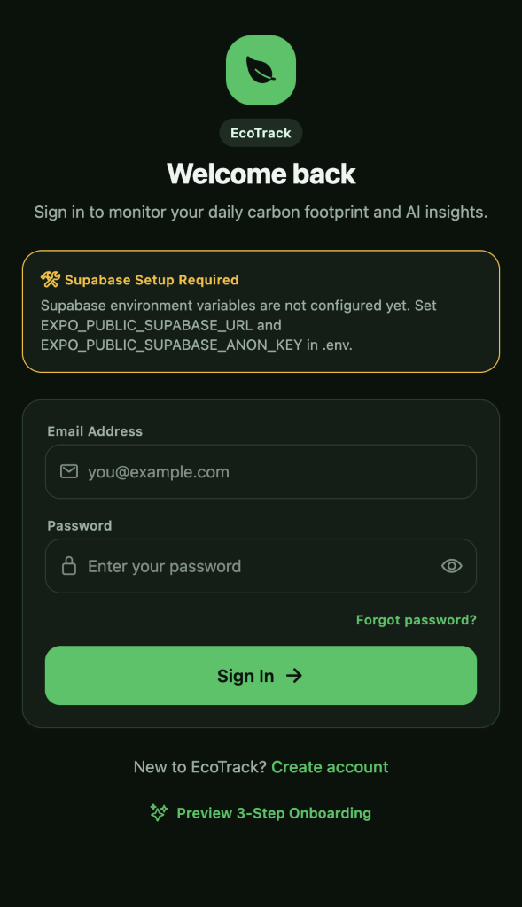

# EcoTrack — AI-Powered Sustainability Companion

**EcoTrack** is a cross-platform mobile sustainability companion built with **React Native, Expo (SDK 58), TypeScript, Expo Router, a self-contained Node.js (`node:http` + `node:sqlite`) backend, and Gemini AI**. It empowers individuals to monitor, calculate, analyze, and reduce their personal carbon footprint using deterministic, peer-reviewed environmental emission factors combined with actionable gamification and personalized AI guidance.

---

## Table of Contents

- [Project Overview](#project-overview)
- [Problem Statement](#problem-statement)
- [Objectives](#objectives)
- [Technology Stack](#technology-stack)
- [System & Application Architecture](#system--application-architecture)
- [SQLite Database Schema](#sqlite-database-schema)
- [Application Modules](#application-modules)
- [Carbon Calculation Methodology](#carbon-calculation-methodology)
- [Gemini AI Assistant Integration](#gemini-ai-assistant-integration)
- [Gamification & Anti-Farming Design](#gamification--anti-farming-design)
- [Security Audit Summary](#security-audit-summary)
- [Testing & Verification Results](#testing--verification-results)
- [Sustainability Benefits & Future Scope](#sustainability-benefits--future-scope)
- [Installation & Quick Start](#installation--quick-start)
- [Project Deliverables Index](#project-deliverables-index)

---

## Project Overview

Climate action at the household and individual level is often hindered by fragmented spreadsheets, opaque emission estimates, and short-lived habit tracking. **EcoTrack** unifies four pillars into a cohesive mobile experience powered directly by a local/self-hosted Node.js backend:

1. **Deterministic Multi-Sector Carbon Accounting**: Auditable emission calculators across Transportation, Home Electricity (12+ regional grids + custom factors), Food, and Lifestyle & Recycling.
2. **Real-Time Analytics & Monthly Reporting**: Interactive SVG trends, period-over-period comparisons, category breakdown donut charts, and exportable CSV / text reports computed directly from persisted SQLite user records.
3. **Privacy-Safe Gemini AI Coach**: Personalized sustainability insights executed inside the authenticated Node.js backend (`POST /api/assistant/chat`) using deterministic function tools so Gemini never invents or guesses arithmetic.
4. **Honest Behavior Gamification**: Daily and weekly green challenges backed by an idempotent SQLite reward ledger (`reward_history`), 5 milestone achievement badges, and a privacy-masked community leaderboard.

<p align="center">
  
</p>

> *EcoTrack connects directly to `npm run backend` (`node backend/server.mjs`) with zero third-party BaaS configuration required.*

---

## Problem Statement

Most consumer carbon-tracking tools suffer from three critical flaws:
- **Unverifiable Calculations**: Generic apps obscure their formulas or use AI text generation to fabricate CO₂e numbers without documented emission factors or unit conversions.
- **Lack of Actionable Context**: Raw emission numbers alone do not tell users *which* category dominates their footprint or quantify how switching commute modes or electricity usage impacts weekly progress.
- **Gamification Loopholes**: Naïve points systems reward users simply for typing lower emission numbers, encouraging inaccurate self-reporting rather than genuine sustainable habits.

---

## Objectives

- Build an intuitive, mobile-first React Native & Expo application with consistent Forest Green (`#166534`), Light Green (`#DCFCE7`), and Off-white (`#F8FAF7`) design tokens (plus full adaptive Dark Mode).
- Run a 100% self-contained **Node.js + SQLite backend** with `scrypt` password hashing, HMAC-SHA256 JWT authentication, user-scoped SQLite queries, and HMAC-signed private avatar URLs.
- Guarantee 100% deterministic carbon math (`CO₂e = Activity Amount × Emission Factor`) using documented 2024 UK DESNZ, IEA, US EPA eGRID2024/WARM v16, Poore & Nemecek, and CEA India factors.
- Integrate Gemini AI securely via `POST /api/assistant/chat` backed by rate limiting and deterministic tools without exposing API keys in the mobile client.
- Reward only completed sustainable challenge actions with server-enforced period deduplication and immutable reward logs.

---

## Technology Stack

| Layer | Technology / Library | Purpose |
|---|---|---|
| **Mobile Framework** | React Native `0.88.1`, Expo `~58.0.25`, React `19.3.0` | Cross-platform iOS, Android, and Web runtime |
| **Language & Navigation** | TypeScript `5.9`, Expo Router (`src/app/`) | Typed file-based stack, bottom-tab routing & `Stack.Protected` guards |
| **UI & Animations** | `react-native-reanimated`, `react-native-safe-area-context`, `react-native-svg`, `@expo/vector-icons`, `expo-image`, `expo-image-picker`, `expo-haptics` | Smooth springs, SVG data visualizations, Safe Area / edge-to-edge layout |
| **Backend & Database** | Node.js `v24.16.0` (`node:http`, `node:sqlite`, `node:crypto`) | REST API (`backend/`), persistent WAL SQLite DB (`ecotrack.db`), JWT sessions, signed private avatars |
| **Server-Side AI Runtime** | Node Backend AI Module (`backend/ai/`) + Gemini Interactions REST API | Authenticated Gemini AI coaching with deterministic function tools & rate limiting |
| **Lint & Diagnostics** | ESLint (`eslint-config-expo`), `tsc --noEmit`, `expo-doctor`, Node `node --test` | Static verification, SDK health checks, and 34 automated unit/security/E2E tests |

---

## System & Application Architecture

```text
+-------------------------------------------------------------------+
|                   EcoTrack Mobile Client (Expo 58)                |
|  src/app/        -> Expo Router screens, tabs & Stack.Protected    |
|  src/context/    -> EcoTrackContext (Auth, Profile, Sync, Cache)   |
|  src/utils/      -> carbonCalculator, analyticsEngine, gamification|
|  src/services/   -> Typed REST clients (`apiClient.ts` + services) |
+---------------------------+---------------------------------------+
                            | HTTP / HTTPS + Bearer JWT
                            v
+-------------------------------------------------------------------+
|               EcoTrack Node.js Backend (`backend/`)               |
|  server.mjs / app.mjs  -> HTTP REST router & health/CORS handling  |
|  auth.mjs              -> scrypt passwords, HS256 JWT, reset codes,|
|                           & HMAC-signed `/api/avatars/...` URLs    |
|  db.mjs                -> `node:sqlite` (WAL) 11 tables + auto-seed|
|  gamification.mjs      -> Period dedup, badges & masked leaderboard|
|  ai.mjs + backend/ai/  -> Rate limits (12/5m, 60/24h), deterministic|
|                           tools, & server-only Gemini REST calls   |
+-------------------------------------------------------------------+
```

### Folder Structure

```text
SusApp/
├── app.json                               # Expo SDK 58 config (com.ecotrack.app, edge-to-edge, plugins)
├── .env.example                           # Client environment template (EXPO_PUBLIC_APP_ENV, EXPO_PUBLIC_API_URL)
├── CALCULATION_METHODOLOGY.md             # Documented emission factors, unit conversions & sources
├── NODE_BACKEND_SETUP.md                  # Node.js + SQLite backend architecture, API & setup guide
├── backend/
│   ├── package.json                       # ESM module configuration (`"type": "module"`)
│   ├── .env.example                       # Server-only secrets template (`PORT`, `ECOTRACK_JWT_SECRET`, `GEMINI_API_KEY`)
│   ├── server.mjs                         # Node backend entrypoint (`npm run backend`)
│   ├── env.mjs                            # Env loader & persistent local `.jwt-secret` management
│   ├── db.mjs                             # `node:sqlite` schema (11 tables) & idempotent seed catalog
│   ├── auth.mjs                           # scrypt hashing, HS256 JWTs, reset codes & signed avatar URLs
│   ├── app.mjs                            # HTTP REST router & user-scoped data endpoints
│   ├── gamification.mjs                   # Server-enforced period dedup, badges & leaderboard queries
│   ├── ai.mjs                             # SQLite rate-limiter & Gemini Interactions REST integration
│   └── ai/                                # Deterministic carbon tools, personalization dossier & handler
├── docs/
│   ├── TESTING_CHECKLIST.md               # Verified test results & release device checklist
│   ├── ANDROID_BUILD_AND_DEMO_GUIDE.md    # EAS & local Android APK/AAB build + 5-min demo guide
│   └── screenshots/                       # Verified UI screenshots
├── scripts/
│   ├── testCalculationEngine.mjs          # Deterministic carbon math tests (10 cases)
│   ├── testAnalyticsEngine.mjs            # KPI reconciliation & chart series tests (6 cases)
│   ├── testAiAssistant.mjs                # AI backend security & tool tests (5 cases)
│   ├── testGamification.mjs               # Gamification period/badge/anti-farming tests (8 cases)
│   ├── testAuditAndSecurity.mjs           # Backend auth, env secret, UI/nav & AI hardening tests (4 cases)
│   └── testNodeBackend.mjs                # Full HTTP lifecycle E2E test suite (1 comprehensive suite)
└── src/
    ├── app/                               # Expo Router routes & navigators
    │   ├── _layout.tsx                    # Root Stack with Stack.Protected auth/recovery guards
    │   ├── onboarding.tsx                 # 3-slide interactive onboarding carousel
    │   ├── reset-password.tsx             # Recovery code / token password reset screen
    │   ├── challenges.tsx                 # Green Challenges Hub, Badges & Community Leaderboard
    │   ├── +not-found.tsx                 # Clean fallback route
    │   ├── activity/[id].tsx              # Activity inspection, deterministic recalc edit & delete
    │   ├── (auth)/                        # Login, Register & Forgot Password screens
    │   └── (tabs)/                        # Bottom Tabs: Home, Calculate, Analytics, AI Assistant, Profile
    ├── components/                        # Reusable UI primitives, analytics charts & calculator modules
    ├── constants/                         # Theme design tokens, emission factors & app config
    ├── context/                           # EcoTrackContext state provider
    ├── hooks/                             # useTheme, useAppConfig, usePressAnimation
    ├── services/                          # Typed Node REST client & domain API modules
    ├── types/                             # Shared TypeScript interfaces
    └── utils/                             # Calculators, analytics engine, gamification, validation, env
```

---

## SQLite Database Schema

[`backend/db.mjs`](backend/db.mjs) automatically initializes 11 relational tables in SQLite (`WAL` mode + `PRAGMA foreign_keys = ON`) with `CHECK` and `UNIQUE` constraints:

- `users` & `password_resets`: Salted `scrypt` authentication credentials and hashed expiring password reset codes.
- `profiles`: Per-user `daily_carbon_budget_kg`, `sustainability_points`, `sustainability_score`, `level_title`, `eco_streak_days`, `preferred_unit`, `electricity_region`, `custom_electricity_factor_kg`, and privacy preferences.
- `carbon_activities` & `carbon_emission_records`: 18 seeded system presets plus user-scoped logged activities storing factor, `region_code`, `methodology_source`, and `assumptions`.
- `challenges`, `user_challenges`, `achievements`, & `reward_history`: 10 daily/weekly green challenges, period-keyed user progress (`UNIQUE (user_id, challenge_id, period_key)`), 5 canonical achievement badges per user, and an immutable reward ledger (`UNIQUE (user_id, reward_key)`).
- `ai_chat_messages` & `ai_request_logs`: Persisted AI conversation turns with deterministic tool calculation citations plus per-user rate-limiting audit logs.

---

## Application Modules

1. **Onboarding (`src/app/onboarding.tsx`)**: Three-step guided welcome introducing daily carbon tracking, challenges/streaks, and Gemini AI insights.
2. **Authentication (`src/app/(auth)/`, `src/app/reset-password.tsx`)**: Registration, email/password sign-in, AsyncStorage token persistence verified against `GET /api/auth/me`, local recovery code password reset, and `Stack.Protected` route gating.
3. **Home Dashboard (`src/app/(tabs)/index.tsx`)**: Time-of-day greeting, Daily CO₂e & Target Budget bar, Weekly Footprint, Sustainability Score & tier badge, 2x2 Quick Actions grid, interactive Daily Green Tip carousel, and Recent Activities list.
4. **Carbon Calculator (`src/app/(tabs)/calculate.tsx`)**: Interactive sector modules for Transportation (7 modes), Electricity (monthly/daily & household split), Food (vegetarian/non-veg/dairy/waste), and Lifestyle (water/waste/recycling), showing live factor formulas before saving to the Node backend.
5. **Activity Detail & Editor (`src/app/activity/[id].tsx`)**: Inspect stored methodology sources/assumptions, recalculate emissions dynamically when editing quantities, update local dates, or delete entries.
6. **Sustainability Analytics (`src/app/(tabs)/analytics.tsx` + `src/components/analytics/`)**: Pull-to-refresh KPIs + **6 interactive charts** (*Daily Trend*, *Weekly Comparison*, *Monthly Comparison*, *Category Donut*, *Transport vs Electricity*, *Personal Progress Over Time*), date/category filters, searchable Activity History, and exportable Monthly Reports (`.txt` / `.csv`).
7. **Gemini AI Assistant (`src/app/(tabs)/assistant.tsx`)**: Conversational sustainability coach with personalized activity summary bar, suggested dynamic follow-ups, daily quota counter badge, verified calculation citation cards, error retry handling, and history clearing.
8. **Green Challenges, Badges & Leaderboard (`src/app/challenges.tsx`)**: Filterable Daily & Weekly challenges, action reflection notes, Eco Points reward ledger, 5 achievement badges (*First Green Step*, *Plastic-Free Hero*, *Energy Saver*, *Eco Warrior*, *Carbon Champion*), and privacy-conscious community leaderboard.
9. **Profile & Settings (`src/app/(tabs)/profile.tsx`)**: Edit display name & private signed avatar upload (`expo-image-picker`), adjust Daily CO₂e budget, choose default Regional Electricity Grid or custom tariff factor, toggle Metric/Imperial units & Leaderboard visibility, inspect Node API connection health & security status, and sign out.

---

## Carbon Calculation Methodology

All numerical emission calculations execute deterministically in [`src/constants/emissionFactors.ts`](src/constants/emissionFactors.ts) and [`src/utils/carbonCalculator.ts`](src/utils/carbonCalculator.ts) (mirrored identically inside the Node backend at [`backend/ai/factors.ts`](backend/ai/factors.ts)):

$$\text{CO}_2\text{e (kg)} = \text{Activity Amount (canonical units)} \times \text{Emission Factor (kg CO}_2\text{e / unit)}$$

- **Zero AI Factor Fabrication**: Gemini never estimates or guesses CO₂e numbers.
- **Documented Sources**: 2024 UK DESNZ GHG Conversion Factors, IEA Global Grid Benchmark, US EPA eGRID2024 & WARM v16, Poore & Nemecek (*Science*, 2018), Scarborough et al. (*Nature Food*, 2023), and CEA India CO₂ Baseline Database v20.0.
- Full factor tables, unit conversion constants, and per-activity assumptions live in [`CALCULATION_METHODOLOGY.md`](CALCULATION_METHODOLOGY.md).

---

## Gemini AI Assistant Integration

EcoTrack's AI coach is hosted exclusively inside the Node.js backend ([`backend/ai.mjs`](backend/ai.mjs) + [`backend/ai/`](backend/ai/)):
- **Zero Client Secrets**: `src/utils/env.ts` actively blocks `EXPO_PUBLIC_GEMINI_API_KEY` or server secrets if accidentally placed in `.env`. The Node backend reads `GEMINI_API_KEY` solely from `backend/.env` or server process environment variables.
- **Authenticated Context Injection**: Every prompt validates the user's Bearer JWT, loads their private footprint records, regional electricity grid, challenges, and badges from SQLite (`backend/ai/personalization.ts`), and enforces server-side rate limits (`12` requests / 5 minutes; `60` requests / 24 hours).
- **Grounded Function Calling (`backend/ai/tools.ts`)**: Gemini invokes deterministic backend tools (`get_user_footprint_analytics`, `calculate_transport_comparison`, `calculate_electricity_impact`, `calculate_food_comparison`, `calculate_lifestyle_impact`) so quoted comparisons and savings always display verified `Calculations` citations.

---

## Gamification & Anti-Farming Design

- **Actions Over Carbon Numbers**: Logging carbon activities via `POST /api/emissions` awards **0 Eco Points**, preventing users from gaming points by entering low numbers.
- **Idempotent Ledger (`reward_history`)**: Every point grant uses a unique `reward_key` (`challenge:<id>:<period_key>` or `badge:<key>`) wrapped in an immediate SQLite write transaction (`backend/gamification.mjs`) so duplicate same-day or same-week claims are blocked on the server.
- **Privacy-First Leaderboard**: `GET /api/leaderboard` never returns user emails or internal credentials—only `leaderboard_opt_in = 1` members using truncated `First L.` formatting (`format_privacy_display_name`).

---

## Security Audit Summary

| Audit Domain | Verification & Enforcement |
|---|---|
| **API Key Protection** | Zero Gemini keys or Supabase secrets in `src/`, `.env.example`, or exported web bundles (`@supabase/supabase-js` and `@google/genai` completely removed from `package.json`; runtime guards active in `src/utils/env.ts`) |
| **Authentication & Ownership** | Per-user salted `scrypt` password hashing + constant-time verification; HMAC-SHA256 Bearer JWT required on all user routes (`401` if missing/invalid); `WHERE user_id = ?` scoping across all SQLite queries |
| **Mass-Assignment Safety** | `PATCH /api/profile` rejects client attempts to alter `sustainability_points`, `eco_streak_days`, `level_title`, or `sustainability_score` |
| **Private File Storage** | Avatars stored outside static routes under `backend/uploads/avatars/` and served only via short-lived HMAC-signed URLs (`/api/avatars/:userId/:filename?exp=...&sig=...`) |
| **AI Endpoint Hardening** | Validates Bearer JWT, checks server `GEMINI_API_KEY` availability before burning rate-limit quota (`503`), caps prompt/history sizes, and redacts token/key patterns from outgoing error payloads |

---

## Testing & Verification Results

All automated test suites, static checks, diagnostics, and live Node-backend + exported web E2E flows are documented in [`docs/TESTING_CHECKLIST.md`](docs/TESTING_CHECKLIST.md):

- **Automated Test Suites (`node --test`)**: **34/34 tests passing** across `testCalculationEngine.mjs` (10), `testAnalyticsEngine.mjs` (6), `testAiAssistant.mjs` (5), `testGamification.mjs` (8), `testAuditAndSecurity.mjs` (4), and `testNodeBackend.mjs` (1 full HTTP lifecycle E2E test).
- **Typecheck & Lint**: `npx tsc --noEmit` (`0` errors), `npx eslint .` (`0` errors, `0` warnings), `npx expo lint` (`exit 0`).
- **Expo Health Diagnostics**: `npx expo-doctor` passed **20/20 checks**.
- **Live Node Backend + Web UI Flows**: Tested against live `npm run backend` (`http://127.0.0.1:3001`) + exported web build (`dist/`), covering registration, authentication persistence, calculator emissions CRUD, analytics reconciliation, daily/weekly challenge completion & duplicate block, badges, profile settings, logout, and local password reset.

---

## Sustainability Benefits & Future Scope

### Sustainability Benefits
- Makes invisible daily carbon sources (electricity grid mix, diet shifts, solo petrol commuting, landfill food waste) tangible in clear `kg CO₂e` units.
- Surfaces personalized, quantified alternatives (e.g., exact savings from switching trips to rail/bus/cycling or cutting household kWh) grounded in verified emission baselines.
- Reinforces persistent low-carbon habits through non-gameable daily/weekly commitments and milestone recognition.

### Future Scope
- Smart utility bill OCR & optional smart-meter / EV charger integrations (verified telemetry tiers alongside self-attested challenges).
- Offline optimistic write queue so logged activities in low-connectivity transit zones sync automatically once reconnected.
- Household / workplace group challenges and regional benchmark comparisons across climate zones.

---

## Installation & Quick Start

### 1. Clone & Install Dependencies

```bash
git clone <your-repository-url>
cd SusApp
npm install
```

### 2. Configure Environment Variables

Client configuration (`.env` already defaults to local development):

```bash
cp .env.example .env
```

```env
EXPO_PUBLIC_APP_ENV=development
EXPO_PUBLIC_API_URL=http://localhost:3001
```

Optional server-side Gemini setup (`backend/.env` — see [`NODE_BACKEND_SETUP.md`](NODE_BACKEND_SETUP.md)):

```bash
cp backend/.env.example backend/.env
# Add GEMINI_API_KEY=your-server-side-gemini-api-key inside backend/.env
```

### 3. Start the Node.js Backend (`Terminal 1`)

```bash
npm run backend
```

### 4. Start EcoTrack App (`Terminal 2`)

```bash
npx expo start
```

Press `i` for iOS Simulator, `a` for Android Emulator, `w` for Web, or scan the QR code in Expo Go. Note that `src/services/apiClient.ts` automatically maps Android Emulator requests to `http://10.0.2.2:3001`.

---

## Project Deliverables Index

- **Client Environment Template**: [`.env.example`](.env.example)
- **Node Backend Implementation**: [`backend/`](backend/)
- **Node Backend Setup & API Guide**: [`NODE_BACKEND_SETUP.md`](NODE_BACKEND_SETUP.md)
- **Carbon Methodology Reference**: [`CALCULATION_METHODOLOGY.md`](CALCULATION_METHODOLOGY.md)
- **Testing & Release Checklist**: [`docs/TESTING_CHECKLIST.md`](docs/TESTING_CHECKLIST.md)
- **Android Build & Demo Guide**: [`docs/ANDROID_BUILD_AND_DEMO_GUIDE.md`](docs/ANDROID_BUILD_AND_DEMO_GUIDE.md)
- **Verified UI Screenshot**: [`docs/screenshots/login-web.png`](docs/screenshots/login-web.png)
